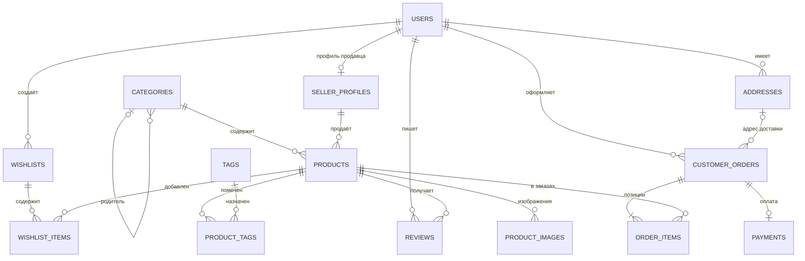

# Лабораторная работа № 1 — база данных маркетплейса

## Цель и результат

Спроектирована реляционная база данных маркетплейса: концептуальная модель, ограничения целостности и повторно запускаемый DDL-скрипт PostgreSQL 15+. В проекте 14 таблиц. ER-модель находится в [ER-диаграмме](ER_diagram.mmd), SQL — в [`01_schema.sql`](01_schema.sql).

## Принятые правила предметной области

- Пользователь может быть покупателем и иметь ровно один профиль продавца; профиль продавца принадлежит одному пользователю.
- У пользователя может быть несколько адресов, но только один адрес по умолчанию. Заказ может ссылаться на адрес только своего покупателя.
- Категории образуют дерево. Родительская категория необязательна; циклы запрещены.
- Товар принадлежит одному продавцу и одной категории. Изображений у товара может быть несколько.
- Заказ принадлежит одному покупателю и содержит не менее одной позиции. Позиция связывает заказ с товаром и хранит количество и цену на момент покупки.
- Для заказа предусмотрен не более чем один платёж. Покупатель может оставить один отзыв на товар.
- Теги и товары связаны отношением M:N через `product_tags`; списки желаний и товары — через `wishlist_items`.
- Удаление пользователя ограничено, если он является покупателем заказа или автором отзыва. Зависимые изображения, списки желаний и позиции удаляются каскадно там, где это безопасно.

## ER-модель



## Таблицы и словарь данных

Типы PostgreSQL указаны явно; `PK` — первичный ключ, `FK` — внешний ключ, `UQ` — уникальность, `NN` — `NOT NULL`.

| Таблица | Поля (тип; ключи и назначение) |
|---|---|
| `users` | `user_id BIGINT` PK identity; `email TEXT` NN UQ; `password_hash TEXT` NN; `full_name TEXT` NN; `phone TEXT` UQ; `created_at TIMESTAMPTZ` NN default now. Учётная запись пользователя. |
| `seller_profiles` | `seller_id BIGINT` PK identity; `user_id BIGINT` NN FK UQ → users; `display_name TEXT` NN UQ; `legal_name TEXT` NN; `tax_number TEXT` NN UQ; `created_at TIMESTAMPTZ` NN. Профиль продавца. |
| `addresses` | `address_id BIGINT` PK identity; `user_id BIGINT` NN FK → users; `country, city, street, postal_code TEXT` NN; `is_default BOOLEAN` NN default false. Адреса пользователей. Дополнительная составная UQ `(address_id,user_id)` поддерживает составной FK заказа. |
| `categories` | `category_id BIGINT` PK identity; `parent_category_id BIGINT` FK → categories; `name TEXT` NN UQ; `description TEXT`. Дерево категорий. |
| `products` | `product_id BIGINT` PK identity; `seller_id BIGINT` NN FK; `category_id BIGINT` NN FK; `title TEXT` NN; `description TEXT`; `price NUMERIC(12,2)` NN > 0; `stock_qty INTEGER` NN ≥ 0 default 0; `is_active BOOLEAN` NN default true; `created_at TIMESTAMPTZ` NN. Карточки товаров. |
| `product_images` | `image_id BIGINT` PK identity; `product_id BIGINT` NN FK; `image_url TEXT` NN; `sort_order INTEGER` NN ≥ 0; UQ `(product_id,image_url)`. Изображения товара. |
| `customer_orders` | `order_id BIGINT` PK identity; `buyer_id BIGINT` NN FK → users; `shipping_address_id BIGINT` FK в паре с buyer_id к addresses; `status TEXT` NN с ограниченным набором значений; `placed_at TIMESTAMPTZ` NN default now. Заказы. |
| `order_items` | `order_id BIGINT` PK/FK; `product_id BIGINT` PK/FK; `quantity INTEGER` NN > 0; `unit_price NUMERIC(12,2)` NN > 0. Ассоциативная таблица M:N и снимок цены на момент заказа. |
| `payments` | `payment_id BIGINT` PK identity; `order_id BIGINT` NN FK UQ; `amount NUMERIC(12,2)` NN > 0; `method TEXT` NN из card/sbp/cash; `status TEXT` NN из pending/succeeded/failed/refunded; `paid_at TIMESTAMPTZ`. Платёж заказа. |
| `reviews` | `review_id BIGINT` PK identity; `product_id BIGINT` NN FK; `author_id BIGINT` NN FK; `rating SMALLINT` NN 1–5; `body TEXT` NN; `created_at TIMESTAMPTZ` NN; UQ `(product_id,author_id)`. Отзывы. |
| `tags` | `tag_id BIGINT` PK identity; `name TEXT` NN UQ. Справочник тегов. |
| `product_tags` | `product_id BIGINT` PK/FK; `tag_id BIGINT` PK/FK. Связь товаров и тегов M:N. |
| `wishlists` | `wishlist_id BIGINT` PK identity; `user_id BIGINT` NN FK; `name TEXT` NN default «Избранное»; `created_at TIMESTAMPTZ` NN; UQ `(user_id,name)`. Списки желаний. |
| `wishlist_items` | `wishlist_id BIGINT` PK/FK; `product_id BIGINT` PK/FK; `added_at TIMESTAMPTZ` NN default now. Состав списка желаний, связь M:N. |

## Ключи и нормализация

В качестве первичных ключей выбраны суррогатные `BIGINT GENERATED ALWAYS AS IDENTITY`: они компактны и не зависят от изменяемых деловых атрибутов. Естественные ключи, которые действительно уникальны по правилам модели, дополнительно защищены `UNIQUE` (например, email, ИНН продавца, имя тега). Для отношений M:N используются составные первичные ключи пары FK, чтобы одна и та же пара не повторялась.

Схема соответствует 3НФ: поля атомарны; неключевые атрибуты каждой таблицы зависят от ключа, всего ключа и ничего кроме ключа. Данные продавца не копируются в товар, а данные категории — в карточку товара. Повторяемые изображения, позиции заказа, теги, отзывы и адреса вынесены в отдельные отношения.

**Аномалия до нормализации.** Представим одну таблицу `ЗаказСтрока(номер_заказа, покупатель, email, товар, название_товара, продавец, количество, цена)`. При заказе из двух товаров имя/email покупателя и данные продавца многократно повторяются. Изменение email требует обновить все строки покупателя; при удалении последней строки товара теряются его название и продавец; вставить новый товар без заказа нельзя. Разделение на `users`, `products`, `customer_orders`, `order_items` устраняет эти аномалии. `unit_price` в строке заказа оставлен намеренно: это историческая цена покупки, а не дублирование текущей цены товара.

## Целостность и повторный запуск

Скрипт [`01_schema.sql`](01_schema.sql) создаёт схему `marketplace`, таблицы, ограничения, индексы и триггеры в одной транзакции. Он предназначен для повторного запуска в учебной базе: сначала удаляет `marketplace CASCADE`, поэтому при повторе уничтожает данные этой схемы. Нужен PostgreSQL 15 или новее из-за синтаксиса частичного `ON DELETE SET NULL` у составного FK.

Запуск в `psql`:

```text
psql -U postgres -d postgres -v ON_ERROR_STOP=1 -f lab01/01_schema.sql
```

В pgAdmin можно открыть Query Tool базы данных и выполнить содержимое файла целиком. При первом подключении введите пароль, заданный вами в мастере PostgreSQL; пароль в репозиторий и отчёт не помещается.

Ключевые проверки: `CHECK` ограничивают цены, остатки, количество и рейтинг; FK задают правила удаления/обновления; частичный уникальный индекс разрешает только один адрес по умолчанию; триггер запрещает циклы категорий; отложенный constraint trigger требует хотя бы одну позицию заказа к `COMMIT`.

## Контрольные вопросы и ответы

1. **Что такое первичный ключ?** Атрибут или набор атрибутов, однозначно идентифицирующий строку; значения PK уникальны и не `NULL`.
2. **Зачем нужны внешние ключи?** Они обеспечивают ссылочную целостность и не позволяют ссылаться на отсутствующие строки.
3. **Что такое кандидатный ключ?** Минимальный набор атрибутов, который однозначно идентифицирует строку; выбранный кандидат становится PK.
4. **Зачем в модели суррогатные ключи?** Они дают стабильный идентификатор, не зависящий от изменяемых бизнес-данных.
5. **Как представить связь M:N в реляционной БД?** Промежуточной таблицей с FK на обе стороны и обычно составным PK этих FK.
6. **Что требует первая нормальная форма?** Одно атомарное значение в каждой ячейке и отсутствие повторяющихся групп столбцов.
7. **Что устраняет вторая нормальная форма?** Частичные зависимости неключевых атрибутов от части составного ключа.
8. **Что устраняет третья нормальная форма?** Транзитивные зависимости неключевых атрибутов через другие неключевые атрибуты.
9. **Чем отличаются `ON DELETE CASCADE` и `RESTRICT`?** `CASCADE` удаляет зависимые строки, `RESTRICT` запрещает удаление родителя при наличии ссылок.
10. **Для чего нужны `CHECK` и триггеры?** `CHECK` выражают построчные условия, а триггеры позволяют проверять более сложные инварианты, например отсутствие цикла или наличие позиций заказа.

## Состав папки

- `01_schema.sql` — DDL, ограничения и триггеры.
- `ER_diagram.mmd` — исходник ER-диаграммы Mermaid.
- `README.md` — отчёт, словарь данных, обоснования и ответы.
