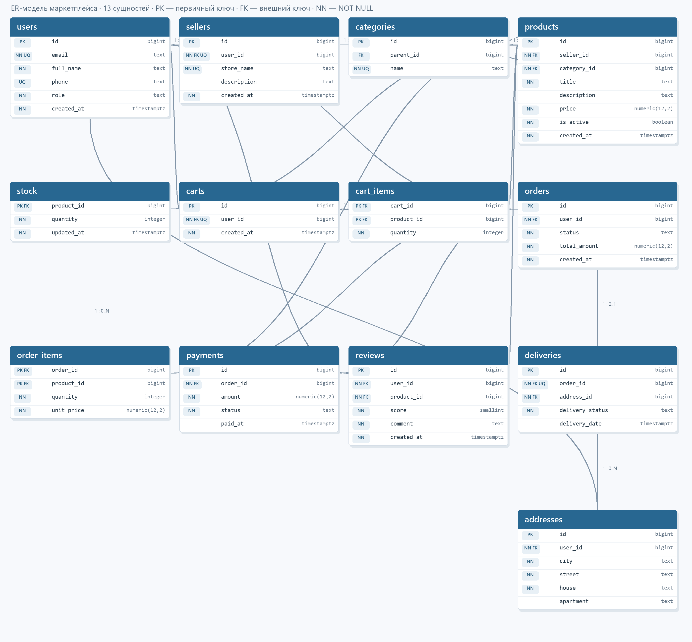

# Лабораторная работа № 1 — структура базы данных маркетплейса

## Цель

Спроектировать ER-модель и реализовать её в PostgreSQL 15+ с ключами, ограничениями целостности и повторно запускаемым SQL-скриптом.

## ER-диаграмма

Диаграмма оформлена как логическая модель из задания: карточки таблиц, столбцы и типы, отметки PK/FK/NN, кардинальности и линии связей. В ней 13 сущностей, ассоциативные таблицы для отношений M:N и самоссылка категорий.



Рисунок построен по структуре SQL-скрипта. Postman предназначен для HTTP/API-запросов; визуальную ER-модель он не строит.

## Бизнес-правила

- Пользователь может иметь один профиль продавца и одну корзину; пользователь оформляет несколько заказов и может хранить несколько адресов.
- Категории образуют дерево с необязательной родительской категорией. Категория не может быть родителем самой себя или своего предка.
- Товар принадлежит одному продавцу и одной категории. Его остаток хранится отдельно — одна строка `stock` на товар.
- Корзина содержит товары через `cart_items`; одна пара «корзина–товар» встречается не более одного раза, количество положительно.
- Заказ принадлежит одному пользователю и содержит одну или более позиций. Позиция связывает заказ с товаром и хранит количество и цену покупки.
- У заказа может быть несколько попыток оплаты и не более одной доставки. Отзыв оставляется пользователем на конкретный товар; повторный отзыв того же пользователя на тот же товар запрещён.
- Удаление товара каскадно удаляет его остаток, но запрещено, если товар включён в заказ или корзину. Удаление заказа удаляет позиции и доставку; удаление пользователя с заказами или отзывами запрещено.

## Словарь данных

`PK` — первичный ключ, `FK` — внешний ключ, `NN` — `NOT NULL`, `UQ` — `UNIQUE`.

| Таблица | Столбцы, типы и назначение |
|---|---|
| `users` | `id BIGINT` PK identity; `full_name TEXT` NN; `email TEXT` NN UQ; `phone TEXT` UQ; `role TEXT` NN CHECK, default `customer`; `created_at TIMESTAMPTZ` NN default now. Учётные записи. |
| `sellers` | `id BIGINT` PK identity; `user_id BIGINT` NN FK UQ → users; `store_name TEXT` NN UQ; `description TEXT`; `created_at TIMESTAMPTZ` NN. Профили продавцов. |
| `categories` | `id BIGINT` PK identity; `parent_id BIGINT` FK → categories; `name TEXT` NN UQ. Иерархия категорий. |
| `products` | `id BIGINT` PK identity; `seller_id BIGINT` NN FK; `category_id BIGINT` NN FK; `title TEXT` NN; `description TEXT`; `price NUMERIC(12,2)` NN CHECK > 0; `is_active BOOLEAN` NN default true; `created_at TIMESTAMPTZ` NN. Карточка товара. |
| `stock` | `product_id BIGINT` PK и FK → products; `quantity INTEGER` NN CHECK ≥ 0 default 0; `updated_at TIMESTAMPTZ` NN. Остаток товара. |
| `carts` | `id BIGINT` PK identity; `user_id BIGINT` NN FK UQ → users; `created_at TIMESTAMPTZ` NN. Корзина пользователя. |
| `cart_items` | `cart_id BIGINT` PK/FK; `product_id BIGINT` PK/FK; `quantity INTEGER` NN CHECK > 0. Ассоциативная таблица корзин и товаров M:N. |
| `orders` | `id BIGINT` PK identity; `user_id BIGINT` NN FK → users; `status TEXT` NN CHECK, default `new`; `total_amount NUMERIC(12,2)` NN CHECK ≥ 0; `created_at TIMESTAMPTZ` NN. Заказы. |
| `order_items` | `order_id BIGINT` PK/FK; `product_id BIGINT` PK/FK; `quantity INTEGER` NN CHECK > 0; `unit_price NUMERIC(12,2)` NN CHECK > 0. Ассоциативная таблица заказов и товаров M:N; цена фиксируется на момент покупки. |
| `payments` | `id BIGINT` PK identity; `order_id BIGINT` NN FK → orders; `amount NUMERIC(12,2)` NN CHECK > 0; `status TEXT` NN CHECK; `paid_at TIMESTAMPTZ`. Попытки и результаты оплаты заказа. |
| `addresses` | `id BIGINT` PK identity; `user_id BIGINT` NN FK → users; `city, street, house TEXT` NN; `apartment TEXT`. Адреса пользователей. |
| `deliveries` | `id BIGINT` PK identity; `order_id BIGINT` NN FK UQ → orders; `address_id BIGINT` NN FK → addresses; `delivery_status TEXT` NN CHECK; `delivery_date TIMESTAMPTZ`. Доставка заказа. |
| `reviews` | `id BIGINT` PK identity; `user_id BIGINT` NN FK → users; `product_id BIGINT` NN FK → products; `score SMALLINT` NN CHECK 1–5; `comment TEXT` NN; `created_at TIMESTAMPTZ` NN; UQ `(user_id,product_id)`. Отзывы. |

## Ключи, связи и нормализация

Суррогатные целочисленные `BIGINT GENERATED ALWAYS AS IDENTITY` выбраны первичными ключами, потому что они компактны и не меняются вместе с деловыми атрибутами. Для уникальных по бизнес-правилам значений добавлены альтернативные ключи `UNIQUE` — например, email, имя магазина и связь продавца с пользователем. У ассоциативных таблиц первичный ключ составлен из пары FK, что также запрещает повтор одной пары.

Модель соответствует 3НФ: в каждой таблице хранятся атомарные значения; неключевые атрибуты зависят от ключа целиком и не зависят транзитивно от других неключевых атрибутов. Например, имя продавца хранится в `sellers`, а не копируется в каждую строку товара. `unit_price` в `order_items` — исторический снимок цены, необходимый для сохранения суммы уже оформленной покупки.

**Аномалия до нормализации.** В одной таблице `ЗаказПозиция(номер_заказа, покупатель, email, товар, название_товара, продавец, количество, цена)` повторяются данные покупателя и товара. Изменение email приходится выполнять во многих строках (аномалия обновления); удаление последней позиции заказа может потерять сведения о товаре (аномалия удаления); товар нельзя добавить, пока он не встречается в заказе (аномалия вставки). Разделение сведений на `users`, `products`, `orders` и `order_items` устраняет эти проблемы.

## Ограничения и действия при удалении

Скрипт использует `PRIMARY KEY`, `FOREIGN KEY`, `NOT NULL`, `UNIQUE`, `CHECK` и `DEFAULT`. `ON DELETE CASCADE` удаляет зависимые строки корзины, позиций заказа и доставки; `RESTRICT` сохраняет историю и запрещает удалять используемые товары, пользователей, адреса и категории. `ON UPDATE CASCADE` передаёт изменение ключа в связанные строки. Триггеры запрещают цикл категорий и проверяют, что заказ содержит позицию к моменту фиксации транзакции.

## Запуск

Единый SQL-скрипт: [`01_schema.sql`](01_schema.sql). Он создаёт схему `marketplace` транзакционно и предназначен для повторного выполнения. Перед запуском сохраните нужные данные: скрипт сначала выполняет `DROP SCHEMA marketplace CASCADE`.

Команда для `psql`:

```text
psql -U postgres -d postgres -v ON_ERROR_STOP=1 -f lab01/01_schema.sql
```

В pgAdmin откройте Query Tool учебной базы, выполните весь файл и затем используйте инструмент ERD для просмотра созданных таблиц и связей. Пароль, заданный при установке PostgreSQL, не включается в проект.

## Контрольные вопросы

1. **Что такое реляционная модель, отношение, кортеж и атрибут?** Реляционная модель представляет данные отношениями-таблицами; кортеж — строка, атрибут — столбец со значением из заданного домена.
2. **Чем отличаются концептуальная, логическая и физическая модели?** Концептуальная описывает предметные сущности и связи; логическая добавляет атрибуты, ключи и кардинальности; физическая задаёт конкретные объекты, типы и ограничения PostgreSQL.
3. **Что такое первичный ключ и каковы его требования?** Это минимальный набор столбцов для однозначного определения строки; значения уникальны, не NULL и стабильны.
4. **Чем отличаются суррогатный и естественный ключи?** Суррогатный создаётся системой и стабилен, но сам по себе не имеет предметного смысла. Естественный образован из бизнес-атрибутов, нагляден, но может измениться или перестать быть уникальным.
5. **Что такое внешний ключ?** Ограничение, которое связывает столбец или набор столбцов с ключом другой таблицы и обеспечивает ссылочную целостность.
6. **Как реализуется связь M:N?** Через ассоциативную таблицу с внешними ключами на обе сущности; обычно пара FK образует составной PK.
7. **Как моделировать дерево категорий одной таблицей?** Самоссылочным FK `parent_id → categories.id`; у корневой категории `parent_id` равен NULL.
8. **Какие ограничения целостности поддерживает PostgreSQL?** PK, FK, NOT NULL, UNIQUE, CHECK и DEFAULT: идентификация строк, ссылки, обязательность, уникальность, проверки условий и значения по умолчанию.
9. **Что такое нормализация и что требуют 1НФ, 2НФ и 3НФ?** Это организация отношений для уменьшения избыточности и аномалий. 1НФ требует атомарности; 2НФ — отсутствия частичной зависимости от части составного ключа; 3НФ — отсутствия транзитивной зависимости неключевых атрибутов от ключа.
10. **Чем отличаются ON DELETE RESTRICT и CASCADE?** RESTRICT запрещает удаление родительской строки при существующих ссылках; CASCADE удаляет зависимые строки автоматически.

## Файлы

- `01_schema.sql` — DDL и ограничения PostgreSQL.
- `ER_diagram.png` — готовая ER-диаграмма в стиле рисунка задания.
